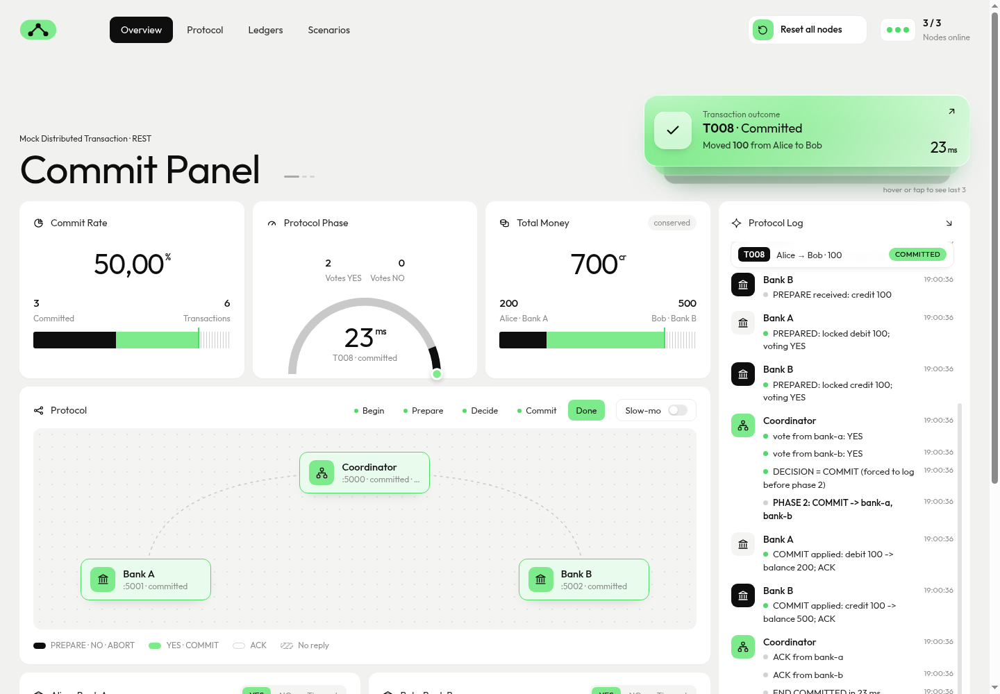

# Mock Two-Phase Commit (2PC) Transaction Coordinator

A small, working demonstration of the **Two-Phase Commit (2PC)** protocol for distributed transactions.



* A **coordinator** exposes a REST API and runs the protocol: **prepare → commit / abort**.
* Two **mock participants** (`bank-a` holds Alice's account, `bank-b` holds Bob's) run as separate HTTP services.
* A **website** (a light, black-and-mint dashboard) animates every protocol message travelling between the nodes. It shows the commit rate, the protocol phase on a gauge, the total money (conserved by atomic commits), both bank ledgers with balance-history charts and live locks, and a chat-style merged log of all three nodes. The log plays in step with the animation and shows one transaction at a time; pull up at the top of the log to load the previous transaction. A *Slow-mo* toggle plays the protocol at under half speed for presentations.
* Every node also writes a plain-text log to `./logs/`.

The example transaction is a money transfer: *debit Alice at Bank A, credit Bob at Bank B*. Either both banks change, or neither does.

---

## Architecture

```
                         ┌────────────────────────────────────┐
     Browser  ──HTTP──▶  │ Coordinator  (coordinator.py :5000) │
   (static/ UI)          │  • REST API  /api/...               │
                         │  • serves the website               │
                         │  • logs/coordinator.log (fsync'd)   │
                         └───────┬───────────────────┬────────┘
                    POST /prepare│ /commit /abort    │POST /prepare /commit /abort
                                 ▼                   ▼
                  ┌───────────────────────┐   ┌───────────────────────┐
                  │ Participant bank-a     │   │ Participant bank-b     │
                  │ participant.py :5001   │   │ participant.py :5002   │
                  │ Alice, balance 500     │   │ Bob,   balance 200     │
                  │ logs/bank-a.log        │   │ logs/bank-b.log        │
                  └───────────────────────┘   └───────────────────────┘
```

**How a transaction runs** (`run_2pc` in `coordinator.py`):

1. **BEGIN**: the coordinator assigns an id (`T001`, …) and logs it.
2. **Phase 1, prepare**: it sends `PREPARE` to both participants in parallel.
   A participant checks whether it *can* commit (enough funds? configured to refuse?).
   If it can, it **locks** the resources (reserves the money), remembers the transaction as *prepared*, and votes **YES**. Otherwise it votes **NO**.
   A participant that does not answer within `VOTE_TIMEOUT` (2 s), or cannot be reached, counts as **NO**.
3. **Decision**: **COMMIT** only if *every* vote is YES, otherwise **ABORT**. The decision is written and `fsync`'d to the coordinator log *before* anyone is told. This is the point of no return.
4. **Phase 2, commit/abort**: the decision goes to both participants. They apply the change or release the lock, then reply **ACK**. Undelivered decisions are retried 3 times.
5. **END**: logged with the outcome and duration.

### Files

| File | Purpose |
|---|---|
| `coordinator.py` | Flask REST coordinator, the 2PC logic, and the web server for the UI |
| `participant.py` | Mock participant (one bank account). Started twice with different arguments |
| `static/` | Website (`index.html`, `style.css`, `app.js`). Plain HTML/CSS/JS, no build step |
| `run.sh` | Starts all three processes. Ctrl+C stops them all |
| `demo.sh` | Command-line demo of the success and abort cases using `curl` |
| `docs/` | Screenshot used in this README |
| `logs/` | Per-node log files (created at runtime, not committed) |

### REST API

**Coordinator** (`:5000`)

| Method & path | Body | Description |
|---|---|---|
| `POST /api/transactions` | `{"amount":100,"from":"bank-a","to":"bank-b"}` | Run one 2PC transaction; returns votes, decision, ACKs |
| `GET /api/transactions` | – | Transaction history |
| `GET /api/log` | – | Coordinator log |
| `GET /api/state` | – | Participants' state, history, and the merged log of all nodes |
| `POST /api/participants/<name>/mode` | `{"mode":"yes"\|"no"\|"timeout"}` | Change how a participant votes |
| `POST /api/reset` | – | Reset balances, modes, logs and history |

**Participant** (`:5001`, `:5002`)

`POST /prepare`, `POST /commit`, `POST /abort`, `GET /state`, `POST /config`, `POST /reset`

Participant vote modes:

* `yes`: normal. Votes YES if the operation is valid (e.g. enough funds).
* `no`: always votes NO, as if a local constraint failed.
* `timeout`: stalls 3.5 s before answering, longer than the coordinator's 2 s timeout.

---

## Running on Ubuntu

Needs Python 3.9 or newer (developed and tested with Python 3.14).

### 1. Dependencies

System packages:

```bash
sudo apt update
sudo apt install -y git python3 python3-venv python3-pip curl
```

Python packages (from `requirements.txt`):

* **Flask** ≥ 3.0, the HTTP/REST server for the coordinator and participants
* **requests** ≥ 2.31, the HTTP client the coordinator uses to talk to participants

The website is plain HTML/CSS/JavaScript with no frameworks, Node or build step. It loads the Outfit font from Google Fonts and falls back to system fonts when offline.

### 2. Install

```bash
git clone https://github.com/DeV-433/Mock-Two-Phase-Commit-2PC-Transaction-Coordinator.git
cd Mock-Two-Phase-Commit-2PC-Transaction-Coordinator
python3 -m venv .venv
source .venv/bin/activate
pip install -r requirements.txt
```

(Ubuntu 23.04+ blocks system-wide `pip install`, which is why a virtual environment is used.)

### 3. Run

```bash
chmod +x run.sh demo.sh
./run.sh
```

Then open **http://localhost:5000** in a browser. `run.sh` uses `.venv` automatically if it exists. Ports 5000–5002 must be free.

To start the processes by hand instead, use three terminals:

```bash
python3 participant.py --name bank-a --port 5001 --holder Alice --balance 500
python3 participant.py --name bank-b --port 5002 --holder Bob   --balance 200
python3 coordinator.py --port 5000
```

Optional environment variables for the coordinator:
`VOTE_TIMEOUT=2.0` and `PARTICIPANTS="bank-a=http://127.0.0.1:5001,bank-b=http://127.0.0.1:5002"`.

### 4. Try the scenarios

**In the website**, click a card in the *Scenarios* row at the bottom of the dashboard:

| Scenario | What happens | Outcome |
|---|---|---|
| **Happy Path** | Both banks vote YES | **COMMITTED**: Alice −100, Bob +100 |
| **Vote NO** | Bank B refuses during prepare; Bank A's lock is released | **ABORTED** |
| **No Funds** | Bank A can't cover 99 999 and votes NO | **ABORTED** |
| **Timeout** | Bank B doesn't answer within 2 s; silence counts as NO | **ABORTED** |

You can also set each bank's vote mode (YES / NO / Timeout) on its ledger card, and send a custom transfer from the box at the bottom of the Protocol Log. Its green pill swaps the direction (Alice → Bob or Bob → Alice).

**From the command line**, with `run.sh` running in another terminal:

```bash
./demo.sh
```

Sample output (trimmed; transaction ids keep counting after a reset, so yours may start higher):

```
== SUCCESS: both vote YES
   T001 COMMITTED {'bank-a': 'YES', 'bank-b': 'YES'}
== ABORT: bank-b votes NO
   T002 ABORTED {'bank-a': 'YES', 'bank-b': 'NO'}
== ABORT: insufficient funds
   T003 ABORTED {'bank-a': 'NO', 'bank-b': 'YES'}
== ABORT: bank-b times out
   T004 ABORTED {'bank-a': 'YES', 'bank-b': 'TIMEOUT'}

== Coordinator log
01:12:05 [T001]  BEGIN transfer 100: debit bank-a, credit bank-b
01:12:05 [T001]  PHASE 1: PREPARE -> bank-a, bank-b (timeout 2.0s)
01:12:05 [T001]  vote from bank-a: YES
01:12:05 [T001]  vote from bank-b: YES
01:12:05 [T001]  DECISION = COMMIT  (forced to log before phase 2)
01:12:05 [T001]  PHASE 2: COMMIT -> bank-a, bank-b
01:12:05 [T001]  ACK from bank-a
01:12:05 [T001]  ACK from bank-b
01:12:05 [T001]  END COMMITTED in 11 ms
01:12:05 [T002]  BEGIN transfer 100: debit bank-a, credit bank-b
...
01:12:05 [T002]  vote from bank-b: NO (participant configured to refuse)
01:12:05 [T002]  DECISION = ABORT  (forced to log before phase 2)
...
01:12:07 [T004]  vote from bank-b: TIMEOUT (no vote within timeout)
01:12:07 [T004]  DECISION = ABORT  (forced to log before phase 2)
01:12:07 [T004]  END ABORTED in 2040 ms
```

The full logs are in `logs/coordinator.log`, `logs/bank-a.log` and `logs/bank-b.log`.

---

## Simplifications (this is a mock)

* State lives in memory. The log files show what a real system would persist, but nodes don't replay them after a restart, so there is no crash *recovery*.
* The coordinator runs one transaction at a time to keep the demo easy to follow.
* Classic 2PC is **blocking**: if the coordinator crashes after participants voted YES, they must hold their locks until it returns. That limitation is the motivation for protocols such as 3PC and Paxos/Raft-based commit.
